# Automatic Prosodic Audio Description Modeling

Code and data accompanying the paper **“Automatic Prosodic Audio Description Modeling”**
(Quintero, Rozo-Torres & Plazas, Universidad Militar Nueva Granada · project INV-ING-4048).

The framework generates Spanish audio description (AD) for short videos and delivers it with
emotion-conditioned prosody: a vision–language model writes the description and selects an
emotion variant from Plutchik's wheel, and a zero-shot TTS model reads it conditioned on a
human narrator's rendition of that variant. The synthesized speech is then compared acoustically
with the narrators' target profiles.

> **Branch `paper`** contains the code, data and examples associated with the paper.
> The full research workspace of the project is on the `main` branch.

---

## Overview

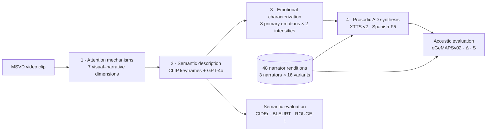

<p align="center">
  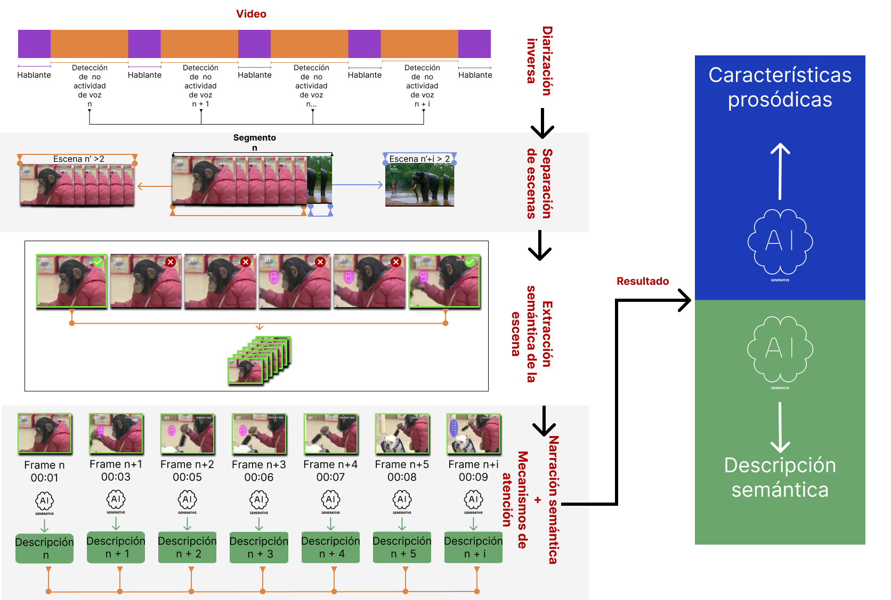<br>
  <sub>Semantic stage: speech-free intervals, scene separation, CLIP keyframe selection and frame-level descriptions.</sub>
</p>

## Key results

| | |
|---|---|
| 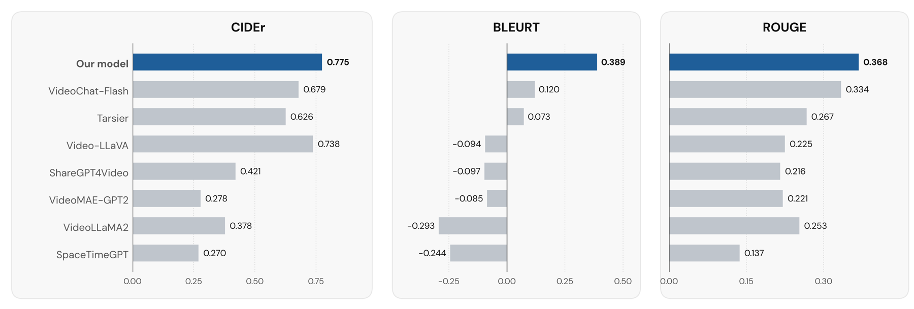 | 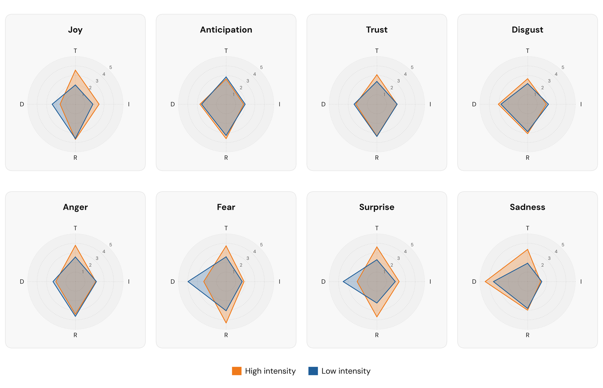 |
| **Semantic similarity.** The pipeline (GPT-4o) obtains the highest CIDEr, BLEURT and ROUGE-L among eight models. | **Reference corpus.** High-intensity variants show higher F0 and faster tempo than low-intensity ones, as predicted by arousal accounts. |
| 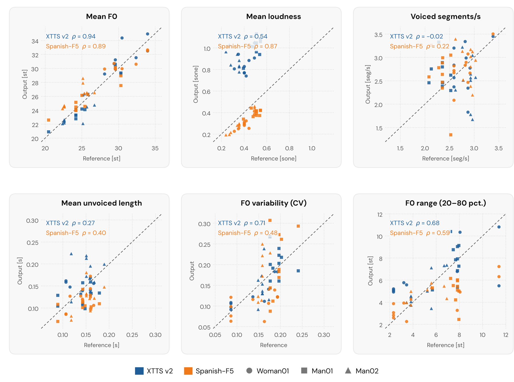 | 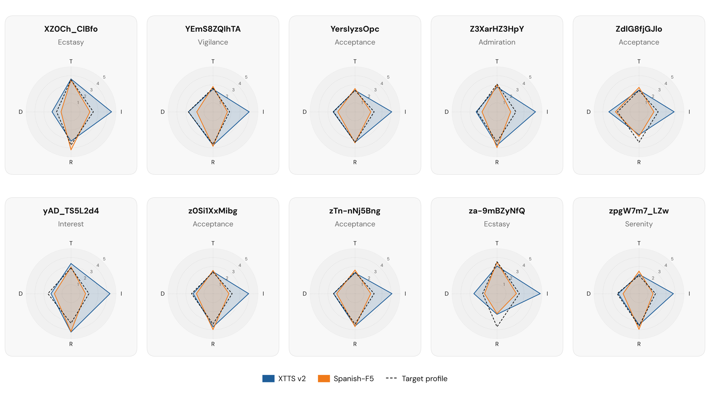 |
| **Prosody transfer.** Both models reproduce the pitch of the conditioning recording (ρ = 0.94 and 0.89) but not its tempo. | **Correspondence.** Most outputs are closer to their intended emotion variant than to the other 15 (27/30 and 29/30). |

## Examples: what the pipeline produces

For each clip, the semantic stage selects keyframes and describes them (`audiodescriptions.json`), assigns an emotion variant with its prosodic instructions (`prosody_analysis.json`) and writes the AD script (`video_summary.json`). All files are in [`data/semantic/`](data/semantic).

🎧 **Synthesized audio.** Three clips include XTTS v2 and Spanish-F5 examples below (`docs/audio/`). All 60 outputs (10 clips × 3 narrators × 2 models)

<details open>
<summary><b>XZ0Ch_ClBfo_120_127</b> · Joy / Ecstasy (high intensity)</summary>

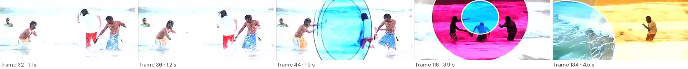

> Cuatro amigos ríen y salpican agua enérgicamente bajo el sol resplandeciente, disfrutando del mar.

Audio: [XTTS v2 (Woman01)](docs/audio/XZ0Ch_ClBfo_120_127_xtts_Woman01.mp3) · [Spanish-F5 (Woman01)](docs/audio/XZ0Ch_ClBfo_120_127_spanish_f5_Woman01.mp3)

https://github.com/Cristianpl08/INV4048/blob/paper/videos_readme/XZ0Ch_ClBfo_120_127_xtts_Woman01.mp4
https://github.com/Cristianpl08/INV4048/blob/paper/videos_readme/XZ0Ch_ClBfo_120_127_spanish_f5_Woman01.mp4


</details>

<details>
<summary><b>YEmS8ZQIhTA_7_20</b> · Anticipation / Vigilance (high intensity)</summary>

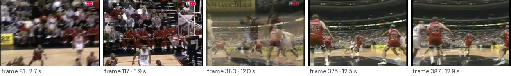

> Un jugador en camiseta blanca avanza rápidamente con el balón, intentando superar la defensa de varios jugadores en uniforme rojo. Una multitud llena el estadio, creando expectación.

Audio: [XTTS v2 (Man01)](docs/audio/YEmS8ZQIhTA_7_20_xtts_Man01.mp3) · [Spanish-F5 (Man01)](docs/audio/YEmS8ZQIhTA_7_20_spanish_f5_Man01.mp3)

https://github.com/Cristianpl08/INV4048/blob/paper/videos_readme/YEmS8ZQIhTA_7_20_xtts_Man01.mp4
https://github.com/Cristianpl08/INV4048/blob/paper/videos_readme/YEmS8ZQIhTA_7_20_spanish_f5_Man01.mp4

</details>

<details>
<summary><b>YersIyzsOpc_15_30</b> · Trust / Acceptance (low intensity)</summary>

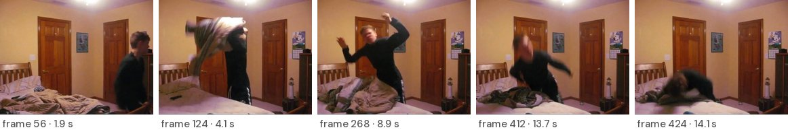

> Una habitación de paredes crema con atmósfera cálida muestra a un joven de ropa oscura, moviéndose rápido sobre una cama desordenada. Su energía es palpable, y al fondo, elementos decorativos añaden un toque personal.

</details>

<details>
<summary><b>Z3XarHZ3HpY_10_17</b> · Trust / Admiration (high intensity)</summary>

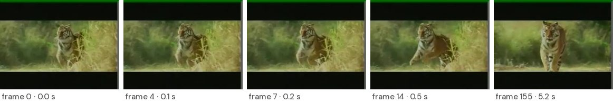

> Un tigre avanza, ágil y decidido, entre la vegetación densa

</details>

<details>
<summary><b>ZdlG8fjGJlo_78_87</b> · Trust / Acceptance (low intensity)</summary>

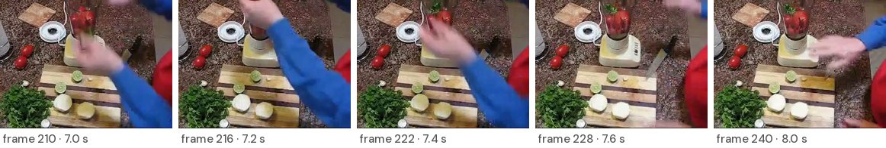

> Manos en movimiento añaden ingredientes frescos a una licuadora. Tomates, cilantro, cebolla y limón se preparan. Cocina animada.

</details>

<details>
<summary><b>yAD_TS5L2d4_4_11</b> · Anticipation / Interest (low intensity)</summary>

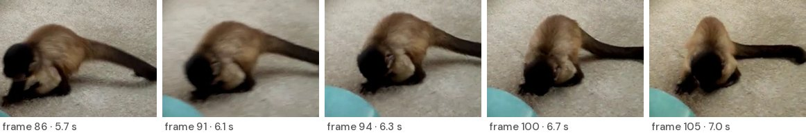

> Mono capuchino curioso inspecciona una pelota azul sobre alfombra beige.

</details>

<details>
<summary><b>z0Si1XxMibg_0_30</b> · Trust / Acceptance (low intensity)</summary>

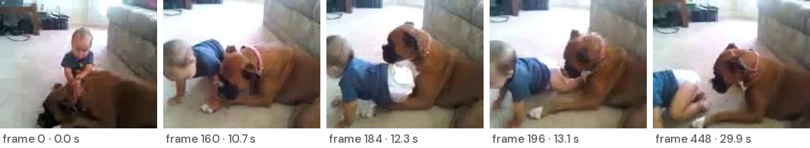

> Un bebé con camiseta azul y pañales gatea sobre una alfombra clara en una sala de estar. Cerca, un perro bóxer de pelaje marrón yace tranquilo, su cabeza cercana al bebé indica una relación afectuosa y protectora. El perro observa suavemente al niño, reflejando confianza y un vínculo seguro entre ambos. La sala, acogedora y bien iluminada por luz natural, refuerza un ambiente de calma familiar.

</details>

<details>
<summary><b>zTn-nNj5Bng_61_77</b> · Trust / Acceptance (low intensity)</summary>

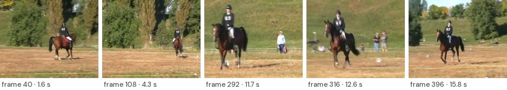

> Un jinete con casco negro y chaqueta número &quot;62&quot; monta un caballo marrón por un campo de hierba seca, rodeado de árboles y cielo despejado. El caballo avanza con elegancia, transmitiendo tranquilidad y aceptación en plena luz del día.

</details>

<details>
<summary><b>za-9mBZyNfQ_330_336</b> · Joy / Ecstasy (high intensity)</summary>

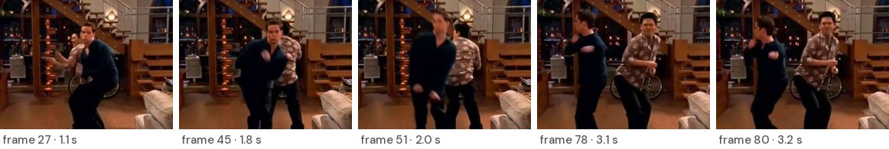

> Dos hombres bailan con energía en una sala iluminada.

</details>

<details>
<summary><b>zpgW7m7_LZw_2_15</b> · Joy / Serenity (low intensity)</summary>

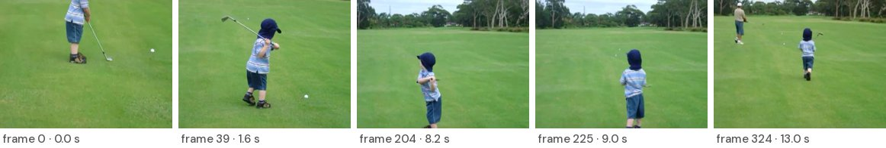

> Un niño pequeño, con camiseta de rayas y gorra azul, sostiene un palo de golf. En un amplio campo verde, se prepara con calma para golpear una pelota blanca. El ambiente tranquilo y soleado envuelve la escena como un suave susurro, resaltando una serenidad indiscutible.

Audio: [XTTS v2 (Man02)](docs/audio/zpgW7m7_LZw_2_15_xtts_Man02.mp3) · [Spanish-F5 (Man02)](docs/audio/zpgW7m7_LZw_2_15_spanish_f5_Man02.mp3)

https://github.com/Cristianpl08/INV4048/blob/paper/videos_readme/zpgW7m7_LZw_2_15_xtts_Man02.mp4
https://github.com/Cristianpl08/INV4048/blob/paper/videos_readme/zpgW7m7_LZw_2_15_spanish_f5_Man02.mp4

</details>

<details>
<summary><b>What the JSON files look like</b> (clip XZ0Ch_ClBfo)</summary>

`audiodescriptions.json`, one entry per keyframe:
```json
{
  "frame_number": 32,
  "filename": "keyframe_32.jpg",
  "description": "En la imagen, cuatro hombres disfrutan de un momento en el mar. Dos de ellos están al frente, aparentemente riendo y salpicando agua. Uno lleva un pantalón corto amarillo y el otro un pareo azul. Otro hombre, de espaldas, viste una camiseta blanca y un pantalón rojo. Al fondo, un cuarto hombre está parcialmente visible, sumergido hasta la cintura. La atmósfera es alegre y relajada, con el brillo del sol reflejándose en el agua."
}
```
`prosody_analysis.json`, the emotion variant and prosodic instructions:
```json
{
  "main_emotion": "Alegría 100%",
  "complementary_emotion": "Éxtasis",
  "intensity": "Alta",
  "tone": "Alto, con variaciones amplias",
  "duration": "Corta, con exclamaciones",
  "rhythm": "Rápido, enérgico, dinámico"
}
```
`video_summary.json`, the AD script and its length constraint:
```json
{
  "emotion": "Éxtasis",
  "char_count": 98,
  "chars_per_second": 13.986013986013985,
  "char_range": [
    71,
    112
  ],
  "main_summary": "Cuatro amigos ríen y salpican agua enérgicamente bajo el sol resplandeciente, disfrutando del mar."
}
```
</details>

## Reverse diarization

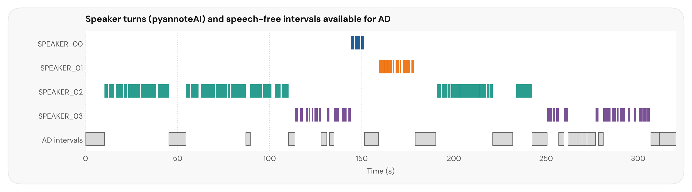

Example output of [`02_diarization`](02_diarization) on a video with dialogue: speaker turns detected with pyannoteAI and the speech-free intervals, split at scene changes, where AD can be inserted. This component is part of the framework but was not evaluated in the paper, because the MSVD clips have no audio.

## Repository structure

| Folder | Contents | Paper section |
|---|---|---|
| [`01_semantic_description/`](01_semantic_description) | CLIP ViT-B/32 keyframe selection, GPT-4o frame descriptions, emotion-variant assignment and global AD script | §3.1–3.4, §4.1–4.2 |
| [`02_diarization/`](02_diarization) | Reverse diarization (pyannoteAI) and scene-aware silence detection. *Framework component, not evaluated in the paper* | §3.2 |
| [`03_reference_synthesis/`](03_reference_synthesis) | Reference-conditioned synthesis with XTTS v2 and Spanish-F5, isolated environments, Colab notebook | §3.5, §4.4 |
| [`04_acoustic_analysis/`](04_acoustic_analysis) | eGeMAPSv02 extraction, deviation Δ, specificity S, statistical tests and all acoustic figures | §4.5–4.6, §5.4–5.6 |
| [`05_semantic_metrics/`](05_semantic_metrics) | CIDEr, BLEURT and ROUGE-L scores of the eight description models | §5.1–5.2 |
| [`data/`](data) | Video list, generated AD texts, eGeMAPS features and result tables (pseudonymized) | — |
| [`docs/`](docs) | README figures, keyframe strips and six audio examples | — |

## Quick start: reproduce the acoustic results

The released feature table is enough to recompute every acoustic number reported in the paper;
no audio or GPU is required.

```bash
pip install pandas numpy scipy
python 04_acoustic_analysis/reproduce_from_features.py
```

To regenerate the figures from audio, or to run the full pipeline on new videos, see the README
inside each folder.

## Data and ethics

- **Videos.** MSVD clips are not redistributed. [`data/videos.csv`](data/videos.csv) lists the
  YouTube IDs and time spans of the ten clips (Chen & Dolan, 2011). Small keyframe thumbnails
  are included only to illustrate the pipeline.
- **Narrator recordings.** The 48 reference renditions are not released. The three narrators are
  identified only by the pseudonyms Woman01, Man01 and Man02.
- **Synthesized speech.** Six example outputs are included in [`docs/audio/`](docs/audio), and
  all 60 outputs are available in the [shared Drive folder](https://drive.google.com/drive/folders/1a8cQmuSHKyddB1qfd3NxhW-5KOPuY1XN?usp=sharing), with the narrators' agreement.
- **Released data** are generated texts and derived measurements (eGeMAPSv02 functionals), which
  do not allow the voices to be reconstructed.
- No blind or low-vision participants took part in this study.

## Citation

```bibtex
@article{Quintero2026ProsodicAD,
  author  = {Quintero, Christian and Rozo-Torres, Alexander and Plazas, Cristian},
  title   = {Automatic Prosodic Audio Description Modeling},
  journal = {Universal Access in the Information Society},
  year    = {2026},
  note    = {Under review}
}
```

## License

Code is released under the [MIT License](LICENSE). Data in `data/` are released under
[CC BY 4.0](https://creativecommons.org/licenses/by/4.0/). DM Sans fonts are distributed under the
SIL Open Font License.

**Funding.** Universidad Militar Nueva Granada, project INV-ING-4048.
